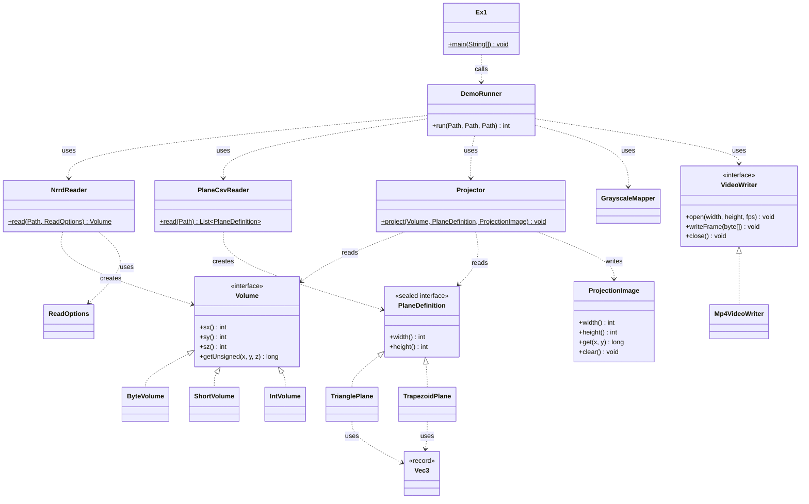

# OOP Ex1 – Plane Projection of a 3D Volume

A Java program that takes a 3D volume (an MRI scan in NRRD format) and a plane, and computes the 2D image of that plane through the volume, like the X/Y/Z views in 3D Slicer, but for any plane. A demo program applies it to a list of planes and writes the images as an MP4 video.

This is Ex1 of the OOP course. The goal is a clean, robust and fast design. The algorithm is the vehicle.

## Status

- [x] 1. Repository, problem and scope (this README)
- [x] 2. SRS document: [docs/SRS.md](docs/SRS.md)
- [x] 3. Main algorithm in detail: SRS section 2.4 and Appendix A
- [ ] 4. Data set of NRRD files: defined in SRS section 5, files still to collect and create
- [x] 5. Testing strategy, including the demo: SRS section 5
- [ ] 6. Implementation (commit frequently)
- [ ] 7. Demo `main`
- [ ] 8. Experiment and its results (see the Experiment section)

## Problem

Given a 3D raster matrix `M` of size `sx*sy*sz` (`1 <= sx,sy,sz < 2^10`) whose entries are unsigned integers of 8, 16 or 32 bits, and a plane `p`, compute the 2D matrix (image) of the projection of `p` in `M`.

The plane is given by points in voxel coordinates:

- **3 points** `(a, b, c)`: an isosceles triangle with `|dist(a,b) - dist(a,c)| < EPS`.
- **4 points** `(a1, a2, b, c)`: an isosceles trapezoid with `|dist(a1,b) - dist(a2,c)| < EPS`, `dist(a1,a2) <= dist(b,c)`, and `a1→b` and `a2→c` in one plane.
- `EPS = 0.001`.

Points of the image that fall outside the volume are `0`.

The assignment says the problem is not well defined for implementation. The SRS closes the open points (rounding, image size, invalid input, signed data) and marks each of them as a design decision.

## Scope

In scope:

- Reading NRRD files: 3 dimensions, unsigned 8/16/32-bit, raw or gzip, little or big endian.
- The projection engine for both plane types, with nearest-neighbour sampling.
- The demo: NRRD + CSV in, MP4 out.
- Unit tests, a reference test, a demo test and a benchmark.
- Speed: at least 30 FPS (must) and 100+ FPS (expected) for the projection of a `500^3` byte volume.

Not in scope (version 1):

- GUI or live display.
- Interpolation other than nearest-neighbour.
- Physical (millimetre) coordinates from the NRRD header.
- Floating-point voxel types.
- Tuning video quality or compression.

## Input and output

**NRRD file.** A 3D volume. Signed types are rejected unless the signed option is on; with it, the file is accepted only if no voxel is negative. (The MRI file used here has type `short`, which is signed.)

**CSV file.** One plane per line, 9 numbers (`a,b,c`) or 12 numbers (`a1,a2,b,c`), each point as `x,y,z` in voxel coordinates. Empty lines are ignored and a non-numeric first line is skipped as a header. This reading of the assignment is a design decision (SRS decision 5). Example for a volume of size 256 x 256 x 130 (voxel `x` from 0 to 255, `y` from 0 to 255, `z` from 0 to 129):

```
planes
128,10,65,10,240,65,246,240,65
0,0,65,255,0,65,0,255,65,255,255,65
0,128,0,255,128,0,0,128,129,255,128,129
128,0,0,128,255,0,128,0,129,128,255,129
```

- Line 1 (after the header line `planes`): a triangle (3 points) in the plane `z = 65`.
- Line 2: a trapezoid (4 points, here a rectangle) that shows the whole slice `z = 65`.
- Line 3: the slice `y = 128`.
- Line 4: the slice `x = 128`.

Because of how the assignment's algorithm steps and rounds sizes, the first row and the last column of such an image can differ by one voxel from a perfect slice. This is expected.

**MP4 file.** One frame per CSV line, in the same order, 10 frames per second. All frames have the same size: the largest plane size, rounded up to even numbers, with each image centred on a black frame. Pixel values are scaled linearly from the volume's minimum and maximum to 0..255.

## How to run

The assignment's format is `python Ex0.py file.nrrd file.csv file.mp4`. This project is in Java, so the equivalent is:

```
Ex1 file.nrrd file.csv file.mp4
```

The exact build and run commands will be written here when the build is set up.

## Getting started (for every team member)

1. Install a JDK, version 17 or later. Check it with `java -version` in a terminal.
2. Install VS Code and the "Extension Pack for Java".
3. Clone the repository: `git clone <repository address>`.
4. Put the MRI file (`MRHead.nrrd`, from the assignment) in a `data/` folder. Check its size on disk: a file under about 50 MB can be committed (the assignment asks us to define a data set of NRRD files); a larger file should go into `.gitignore`, with a note here about where to download it.
5. Look at the header of the NRRD file to see its sizes, type, encoding and endian. How to do it is explained in the SRS, Appendix B3. For our file, the team found: `sizes: 256 256 130` (8,519,680 voxels), `type: short` (signed 16-bit, about 17 MB when unpacked) and `encoding: gzip`. `endian: little` (the 16-bit numbers are stored with the least significant byte first).
6. Read the SRS (especially section 2.4, Appendix A and Appendix B) and the design document before writing code.

## Working together with git

- Before you start working, update your copy: `git pull`.
- Work on different classes, so that you do not change the same lines. The suggested split is in the SRS, Appendix B5.
- Save your work often, with a short message that says what you did:

  ```
  git add .
  git commit -m "Add NrrdReader for raw files"
  git push
  ```

- If `git push` is rejected, run `git pull` first and then `git push` again.
- If two people changed the same lines, git marks the place in the file (`<<<<<<<` and `>>>>>>>`). Decide together what the text should be, delete the markers, then commit.
- Commit frequently, as the assignment requires. Many small commits are better than one large one.

## Documentation

- [docs/SRS.md](docs/SRS.md): PRD and SRS (requirements, algorithm, test data, testing strategy, decisions)
- [docs/DESIGN.md](docs/DESIGN.md): class design

## Design decisions

Short list; the full text is in SRS section 6.

1. Signed voxel data: use the opt-in, and fail if a negative voxel is found.
2. The last row of the image may lie beyond the far edge of the triangle; it is sampled too, as in the assignment's loop.
3. For a trapezoid, `dist(b,c)` is the longer base and gives the image width (from the assignment's Q&A).
4. Image size is limited to 4096 by 4096.
5. CSV format: one plane per line, 9 or 12 numbers. A plane is 3 or 4 points and a line is the natural unit of a list, so the program can tell the cases apart by counting.
6. MP4 encoder: a pure-Java library (for example JCodec) behind the `VideoWriter` interface, so nobody has to install extra programs. Fallback: a writer that calls `ffmpeg`.
7. Video details: gray scaling by the volume's min and max (same brightness scale in every frame), a black frame sized to the largest plane (a video needs one frame size), 10 FPS.

## Testing

- Unit tests for every class.
- A reference test: the fast `Projector` is compared with a slow implementation written directly from the algorithm.
- An end-to-end demo test with a small synthetic volume and a CSV file.
- A separate benchmark for the FPS requirement.

Details and the full test list are in SRS section 5.

## Experiment

*To be written after the demo works.* Plan: run the demo on `MRHead.nrrd` with a CSV of planes (for example the three axis-aligned views and a series of oblique planes), then describe the result, link the MP4 file and report the measured projection speed.

- Command used:
- Number of planes:
- Result (what the video shows):
- Measured FPS of the projection (with the machine used):
- Output video: `results/...mp4`

## Class diagram



The exception classes (`NrrdFormatException`, `CsvFormatException`, `PlaneDefinitionException`) are left out of the diagram; see docs/DESIGN.md.
