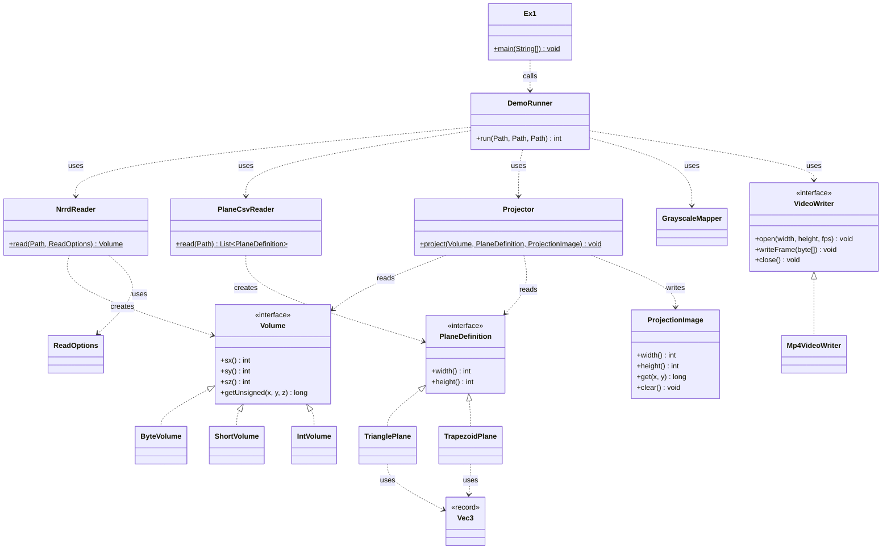

# OOP Ex1 – Design Document

Companion to the PRD and SRS · Version 1.1 (demo classes added) · Java 17

The program has two parts. The **engine** loads a volume, describes a plane and computes the 2D image. The **demo** reads a list of planes from a CSV file and writes the images as an MP4 video. Each class has one job. Input is checked when objects are created, so the projection itself has nothing left to fail on.

## 1. Design goals

- **Correct:** follow the SRS exactly, including its decisions.
- **Fast:** at least 30 FPS (must) and 100+ FPS (expected) on a 500³ byte volume.
- **Easy to test:** every class can be tested alone, and the video encoder can be replaced by a fake one in tests.
- **Easy to extend:** a new voxel type, plane shape or video format should mean a new class, not changes in old ones.

## 2. Overview: how the data flows

```
Engine
  NRRD file --NrrdReader--> Volume            (read-only 3D data)
  3 or 4 points --> PlaneDefinition           (checked and normalised once)
  Projector.project(Volume, PlaneDefinition, ProjectionImage)
                                              --> ProjectionImage (the 2D result E)

Demo (Ex1 file.nrrd file.csv file.mp4)
  CSV file --PlaneCsvReader--> list of PlaneDefinition
  for each plane: Projector --> ProjectionImage --GrayscaleMapper--> frame
  frame --VideoWriter--> MP4 file
```

## 3. Classes

| Class | Kind | Job | Main members |
| --- | --- | --- | --- |
| `Volume` | interface | read-only 3D data of unsigned values | `sx()`, `sy()`, `sz()`, `getUnsigned(x,y,z)` |
| `ByteVolume`, `ShortVolume`, `IntVolume` | final classes | one flat array each (`byte[]`, `short[]`, `int[]`), immutable | the array, strides, `getUnsigned` |
| `NrrdReader` | final class | read a file and build the right `Volume` | `static Volume read(Path, ReadOptions)` |
| `ReadOptions` | immutable class | settings for the reader | `allowSigned` flag |
| `PlaneDefinition` | interface | a checked plane in normalised form | `width()`, `height()`, start and direction numbers |
| `TrianglePlane` | final class | plane from `a, b, c`; validates in the constructor | constructor taking `Vec3` points |
| `TrapezoidPlane` | final class | plane from `a1, a2, b, c`; validates in the constructor | constructor taking `Vec3` points |
| `Vec3` | record | three doubles; used only when creating planes, never in the hot loop | `x`, `y`, `z` |
| `ProjectionImage` | class | the output buffer E, reusable | `width()`, `height()`, `get(x,y)`, `clear()` |
| `Projector` | final class | the algorithm of SRS 2.4 and sampling of 2.5 | `static void project(Volume, PlaneDefinition, ProjectionImage)` |
| `Ex1` | class | the `main` method; only passes arguments on and turns the result into an exit code | `main(String[])` |
| `DemoRunner` | class | runs the demo steps in order (SRS 2.6) | `int run(Path nrrd, Path csv, Path mp4)` |
| `PlaneCsvReader` | final class | read the CSV: one entry for each plane line, either a valid plane or an error with the line number and reason | `static List<PlaneDefinition> read(Path)` |
| `GrayscaleMapper` | class | turn a `ProjectionImage` into 8-bit gray values, using the volume's min and max | `map(image, frameBuffer, ...)` |
| `VideoWriter` | interface | write frames to a video | `open(width, height, fps)`, `writeFrame(byte[])`, `close()` |
| `Mp4VideoWriter` | class | the real implementation, using the chosen encoder (SRS decision 6) | implements `VideoWriter` |
| `NrrdFormatException` | exception (extends `IOException`) | a bad or unsupported NRRD file | message says why |
| `CsvFormatException` | exception (extends `IOException`) | a CSV without any valid plane | message says why |
| `PlaneDefinitionException` | exception (extends `IllegalArgumentException`) | an invalid plane | message says why |

The types of the three exceptions are design decisions [D].

## 4. Why it is built this way

- **One job per class.** Reading files, checking geometry, projecting and writing video are separate, so a bug is easy to locate and each part is easy to test.
- **Validate early (fail fast).** A `PlaneDefinition` that exists is always valid, and a `Volume` that exists is always well formed. So `Projector.project` never throws, as NFR-R1 asks.
- **Immutable objects.** Volumes and planes never change after creation. Nothing needs copying, and the same objects are safe to share between threads.
- **Closed set of plane shapes.** The plane shapes are the two the assignment names. A third shape would be one new class.
- **The engine does not know the demo.** `Projector`, `Volume` and the planes never import the demo classes or the encoder library. The demo depends on the engine, not the other way round.
- **`VideoWriter` is an interface.** `DemoRunner` talks only to the interface. The encoder can be changed in one place, and tests use a fake writer that just counts frames, so the frame count can be checked without decoding a video.
- **A thin `main`.** `Ex1.main` only calls `DemoRunner.run` and sets the exit code. All logic can be tested without starting a program.
- **Speed versus abstraction.** The interface `Volume` is used for loading, tests and general code. The hot loop is different: `Projector` checks the volume type once per frame and then runs a separate loop for byte, short or int data, with the array in a local variable. This repeats some code, but it avoids a virtual call for every voxel. The trade-off is accepted on purpose [D].
- **No allocation per frame in the engine.** `PlaneDefinition` stores its normalised numbers in final `double` fields, computed once in the constructor. `ProjectionImage` is created once and reused.

## 5. Typical use

Engine:

```
Volume v = NrrdReader.read(path, ReadOptions.allowSigned());
PlaneDefinition p = new TrianglePlane(a, b, c);   // may throw PlaneDefinitionException
ProjectionImage img = new ProjectionImage(p.width(), p.height());
Projector.project(v, p, img);                     // never throws
long value = img.get(x, y);
```

Demo steps inside `DemoRunner.run`:

```
1. read the volume                       (NrrdReader)
2. read the CSV: one entry for each line, a plane or an error          (PlaneCsvReader)
3. frame width/height = largest valid plane size, rounded up to even numbers
4. min and max of the volume             (GrayscaleMapper)
5. open the video                        (VideoWriter)
6. for each line, in file order: a plane is projected, mapped to gray and centred on a black frame; an invalid line gets the error frame (SRS FR-D3); then write the frame
7. close the video; return exit code 0
```

## 6. Where each error is caught

| Situation | Caught in | Result |
| --- | --- | --- |
| Wrong number of command-line arguments | `Ex1` | usage message, non-zero exit code |
| Bad, truncated or unsupported NRRD file | `NrrdReader` | `NrrdFormatException` |
| Signed type without the option, or a negative voxel with it | `NrrdReader` | `NrrdFormatException` |
| One CSV line with a wrong value count, text instead of a number, or an invalid plane | `PlaneCsvReader` | the line is kept as an error entry with its line number and reason; `DemoRunner` writes an error frame and prints a warning; exit code 0 |
| A CSV without any valid plane line | `PlaneCsvReader` | `CsvFormatException`, no video, non-zero exit code |
| Invalid plane (checks failed, NaN, collinear, too big) | plane constructor | `PlaneDefinitionException`; `PlaneCsvReader` turns it into an error entry |
| Plane partly or fully outside the volume | `Projector` | pixels are `0`, no error |
| Video file cannot be written | `Mp4VideoWriter` | `IOException`, readable message, non-zero exit code |

`DemoRunner` catches these exceptions, prints the message and returns a non-zero exit code. No video is left behind when the input is bad, because all input is read and checked before the video is opened.

## 7. Performance notes

- Flat primitive arrays; index = `x + sx*(y + sy*z)`.
- Copy sizes, strides and plane numbers into local variables before the loops.
- Round and check bounds on integers exactly as in SRS 2.5, with no object creation.
- Measure first with the protocol of NFR-P1. Only if the target is missed, consider running rows in parallel (results must stay identical).
- Reading the file, gray mapping and video encoding are not part of the FPS measurement.

## 8. Which tests cover which class

| Class | SRS tests |
| --- | --- |
| `NrrdReader`, volumes | 2, 8 |
| `TrianglePlane`, `TrapezoidPlane` | 6, 7 |
| `Projector` | 1, 3, 4, 5, 7, 9, 10 |
| `ProjectionImage` | 1, 9 |
| `PlaneCsvReader` | 11 |
| `GrayscaleMapper` | 12 |
| `DemoRunner`, `Ex1`, `VideoWriter` | 13 |

## 9. Possible extensions (not in v1)

- Interpolation instead of nearest-neighbour, by turning the sampling step into a replaceable strategy.
- Saving single images (PNG or PGM) with another `FrameWriter`.
- Physical (millimetre) coordinates from the NRRD header.

## 10. Class diagram

The diagram below is written as text in the Mermaid language. GitHub draws it as a picture. You can also paste the text into the website mermaid.live to see and export the picture.

How to read it:

- A box is a class. `<<interface>>` marks an interface.
- `A <|.. B` means that class B implements interface A.
- `A ..> B : uses` means that A uses B (it calls it or creates it).
- Methods marked with `$` are static.



The exception classes (`NrrdFormatException`, `CsvFormatException`, `PlaneDefinitionException`) are left out to keep the picture readable; they are described in section 3.

## 11. Suggested package layout

- `engine`: `Volume` and its implementations, `PlaneDefinition` and its implementations, `Vec3`, `ProjectionImage`, `Projector`.
- `io`: `NrrdReader`, `ReadOptions`, `PlaneCsvReader`, and the exceptions `NrrdFormatException` and `CsvFormatException` (`PlaneDefinitionException` is in `engine`).
- `demo`: `Ex1`, `DemoRunner`, `GrayscaleMapper`, `VideoWriter`, `Mp4VideoWriter`.

The rule to keep: `engine` never imports `demo`, and never imports the video library. The terms used in this document are explained in the glossary in Appendix B of the SRS.
